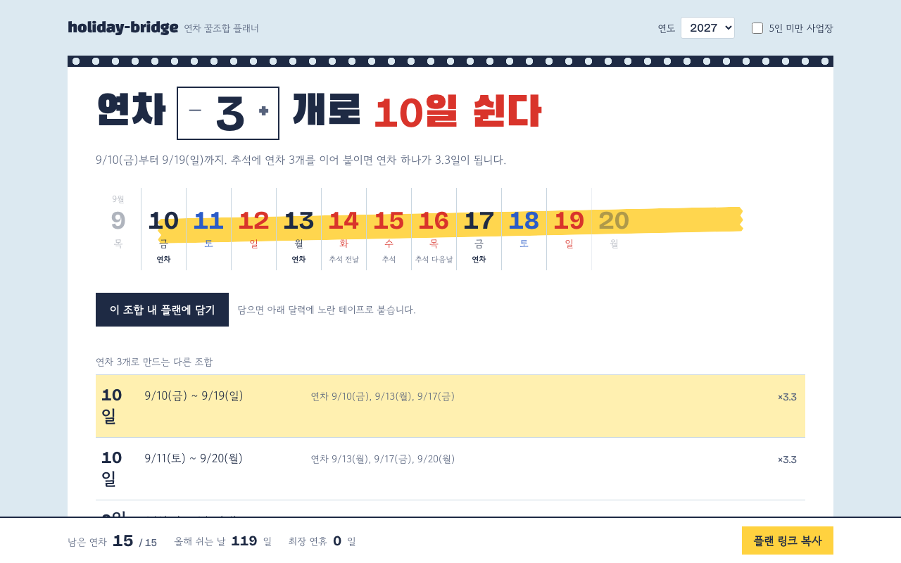

# holiday-bridge

**2027 연차 꿀조합 플래너.** 공휴일 사이에 연차를 다리처럼 놓아, 연차 몇 개로 며칠을 쉴 수 있는지 바로 보여 줍니다.


### 🔗 라이브 데모: LIVE_URL

## 주요 기능

- 🧮 **연차 개수별 최장 연휴 랭킹** — 연차 1~5개로 만들 수 있는 최장 연휴 상위 5개와 효율(쉬는 날 ÷ 연차). 2027년은 추석 앞뒤로 연차 3개 → 10일.
- 📆 **1년 연차 배분 추천** — 보유 연차(기본 15개) 안에서 휴일이 낀 연휴만 골라, 연차로 "덤으로 얻는 휴일"이 가장 많아지는 조합을 DP로 계산.
- 🟨 **12개월 탁상달력** — 공휴일·대체공휴일(빨강), 토요일(파랑), 내 연차(노란 테이프), 추천 연차(점선)를 구분. 평일을 눌러 연차를 직접 붙이고 뗄 수 있습니다.
- 🏢 **5인 미만 사업장 모드** — 관공서 공휴일을 빼고 주말과 노동절(근로자의 날 유급휴일)만 쉰다고 보고 다시 계산. 실제 휴무는 회사 규정에 따라 다릅니다.
- 🔗 **링크로 공유** — 플랜을 URL 쿼리(`?y=2027&t=15&d=0913.0917`)로 인코딩해 서버 없이 공유. 상태는 localStorage 에 자동 저장.

## 휴일 데이터

휴일은 코드에 하드코딩하지 않고 `public/holidays/` 의 JSON 으로 관리합니다.

- `public/holidays/index.json` — `{"years":[2027],"default":2027}` (연도 선택 목록)
- `public/holidays/2027.json` — 우주항공청 2027년도 월력요항(2026.6.29 발표) 기준, 각 항목은 `{date, name, type: "public"|"substitute", scope: "official"|"all"}`
  - `scope: "official"` = 관공서 공휴일(5인 이상 사업장 유급휴일), `"all"` = 사업장 규모와 무관(노동절)

### 임시공휴일·새 연도 반영 방법

1. 해당 연도 JSON 의 `holidays` 배열에 항목 추가 (예: `{"date":"2027-xx-xx","name":"임시공휴일","type":"public","scope":"official"}`), `updatedAt` 갱신
2. 공식 총계가 바뀌면 `officialTotal`(관공서 공휴일 = 일요일 + 일요일 아닌 휴일)도 갱신
3. 새 연도는 `YYYY.json` 을 만들고 `index.json` 의 `years` 에 추가
4. `npx tsx scripts/verify.ts` 로 검산 후 push → Vercel 자동 재배포

## 검산

```bash
npx tsx scripts/verify.ts
```

날짜 형식·요일, 관공서 공휴일 72일(일요일 52 + 일요일 아닌 휴일 20), 평일 휴일 15일·근무일 246일, 연차 1~3개 최장(6·9·10일), 추천안 겹침 여부를 assert 합니다.

## 기술 스택

React 19 · TypeScript · Vite · Tailwind CSS v4 · 순수 클라이언트 알고리즘(최대 구간 열거 + 예산 배낭 DP)

## 로컬 실행

```bash
npm install && npm run dev
```

## 스크린샷


